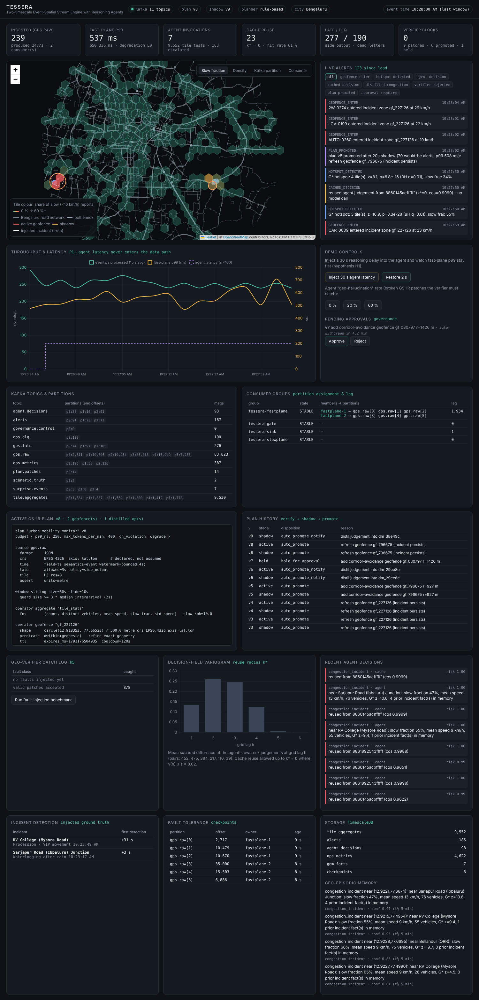

# TESSERA — Geo-Agentic Real-Time Spatial Stream Analytics

A working implementation of the **TESSERA** methodology (Two-timescale Event-Spatial Stream Engine
with Reasoning Agents) as a complete streaming pipeline:

```
Data Source ──► Apache Kafka ──► Stream Processing ──► Storage (TimescaleDB) ──► Analytics / Dashboard
```

Everything is free and open source and runs on **Windows** through Docker Desktop. One double-click
(`start.bat`) builds and starts the whole system and opens the live dashboard.



---

## 1. Quick start (Windows)

1. Install **Docker Desktop for Windows** (free): https://www.docker.com/products/docker-desktop/
   Use the default WSL 2 backend. Start it and wait until it shows **Engine running**.
2. Unzip this folder anywhere (for example `C:\projects\tessera`).
3. Double-click **`start.bat`**.
   The first run downloads the Kafka, TimescaleDB, Kafka UI and Python images (~1.5 GB), so give it
   a few minutes. Later starts take ~30 seconds.
4. The dashboard opens at **http://localhost:8000**. Kafka UI is at **http://localhost:8085**.

What to expect on the dashboard:

| Time after start | What happens |
|---|---|
| ~10 s | Vehicles stream into `gps.raw`; the KPI row shows events/s and fast-plane latency |
| ~45 s | The first congestion incident is injected (white dashed circle on the map) |
| ~70 s | The first 60-second windows close; hexagons appear and are coloured by slow-traffic share |
| ~75 s | The surprise gate flags the hotspot (`HOTSPOT_DETECTED`); the agent reasons about it (`AGENT_DECISION`) |
| ~100 s | The agent's geofence patch is verified, shadow-tested for 20 s, then promoted (red circle, `PLAN_PROMOTED`); vehicles entering it raise `GEOFENCE_ENTER` alerts |
| every 2.5 min | A new incident is injected somewhere else in the city |

Scripts (all double-clickable):

| Script | Purpose |
|---|---|
| `start.bat` | Build and start everything, open the dashboard |
| `stop.bat` | Stop containers (Kafka topics and the database are kept) |
| `status.bat` | Container health plus partition assignment and lag of every consumer group |
| `logs.bat [service]` | Follow logs (`logs.bat fastplane`, `logs.bat slowplane`, …) |
| `demo-kafka.bat` | Topics, partitions, consumer groups and sample messages using Kafka's own CLI |
| `demo-fault-tolerance.bat` | Crash a stream processor and watch rebalance plus checkpoint recovery |
| `scale.bat 3` | Run 3 stream-processor instances in one consumer group |
| `run-tests.bat` | Unit tests inside Docker (no local Python needed) |
| `reset.bat` | Delete everything (containers, topics, database) for a fresh start |

---

## 2. How each required task is demonstrated

| Requirement | Where it is implemented | How to see it |
|---|---|---|
| **Complete pipeline** | `producer` → Kafka → `fastplane` → `gate` → `slowplane`; `sink` → TimescaleDB; `dashboard` | Dashboard, Kafka UI, `logs.bat` |
| **Kafka as the central platform** | Every hop between components is a Kafka topic (11 topics); no service calls another directly | Topic table on the dashboard, `demo-kafka.bat` |
| **≥1 producer and consumer** | Producers: `producer.py`, `fast_plane.py`, `gate.py`, `slow_plane.py`, dashboard controls. Consumers: `fast_plane.py`, `gate.py`, `slow_plane.py`, `sink.py`, dashboard | `tessera/services/*.py` |
| **≥2 topics** | 11 topics: `gps.raw`, `gps.late`, `gps.dlq`, `tile.aggregates`, `surprise.events`, `agent.decisions`, `plan.patches`, `alerts`, `ops.metrics`, `scenario.truth`, `governance.control` | Topic table, Kafka UI |
| **Partitioning** | `gps.raw` and `tile.aggregates` have 15 partitions (3 per city in India mode). The record key is the H3 cell, so all events of an area go to the same partition (partition locality = spatial locality), which keeps per-tile window state on one consumer | Map → **Kafka partition** colour mode; `demo-kafka.bat` |
| **Consumer groups** | `tessera-fastplane` runs **2 instances by default** that share the 15 partitions in India mode; plus `tessera-gate`, `tessera-slowplane` and `tessera-sink`. Plan patches use per-instance groups (broadcast) so every instance receives every plan | Consumer-group table, map → **Consumer** colour mode, `scale.bat 3` |
| **Window-based streaming operation** | Event-time **sliding windows** (60 s size, 10 s slide) with bounded-out-of-orderness watermarks (4 s), allowed lateness (3 s), a late-event side output (`gps.late`) and idle-partition watermark advancement (`windows.py`) | Hexagon map, `Late / DLQ` KPI |
| **Aggregation / summarisation** | Per tile per window: count, distinct vehicles, mean and std of speed (moment sums), slow fraction. Then **Getis-Ord G\*ᵢ** hotspot statistics with **Benjamini–Hochberg FDR** control and connected-component clustering of hotspots (`stats.py`) | Tile tooltips, `HOTSPOT_DETECTED` alerts |
| **Fault tolerance / recovery** | (1) Window state and Kafka offsets are **checkpointed together** to PostgreSQL every 10 s and on partition revoke; on restart or rebalance the new owner restores the state and seeks to the checkpointed offset. (2) Idempotent `acks=all` producers. (3) Manual offset commits only after results are durable. (4) Idempotent sink (deterministic keys plus `ON CONFLICT`), so replays never double-count. (5) The sink rewinds and retries a batch if the database is down. (6) Dead-letter topic for malformed records. (7) `restart: unless-stopped` and reconnect-with-retry everywhere. (8) Graceful SIGTERM handling with a final checkpoint | `demo-fault-tolerance.bat`, Fault-tolerance panel |
| **Database / time-series store** | **TimescaleDB** (PostgreSQL) hypertables: `tile_aggregates`, `alerts`, `agent_decisions`, `surprise_events`, `ops_metrics`, with retention policies; plus `gem_facts`, `plan_versions`, `verifier_reports`, `checkpoints`, and a `city_minute` view | Storage panel; connect to `localhost:5433` (user, password and db are all `tessera`) |
| **Real-time visualisation / alerts** | Live Leaflet map of H3 hexagons, geofences and incidents; live alert feed with 8 alert types; latency and throughput charts; Kafka topology; governance controls | http://localhost:8000 |

---

## 3. Architecture

```
                                   ┌───────────────────────────── FAST PLANE (deterministic, no inference) ─────────────────────────────┐
 producer ──► gps.raw (6 parts) ──►│ fastplane ×2  [group tessera-fastplane]                                                             │
 (500 vehicles, key = H3 res-6 cell │   L0 normalise (CRS, axis order, validation) ──► gps.dlq                                            │
  incidents,                       │   L1 H3 res-8 tile → sliding event-time windows (watermark, lateness) ──► gps.late                  │
  out-of-order,                    │   L2 geofences (k-ring filter + exact geodesic refine), distilled operators ──► alerts               │
  bad records)                     │   checkpoint {window state + offsets} → PostgreSQL                                                  │
                                   └──────────────┬──────────────────────────────────────────────────────────────▲──────────────────────┘
                                                  │ tile.aggregates (6 parts)                                  │ plan.patches (compacted,
                                                  ▼                                                            │  broadcast: shadow/active)
                                   ┌── L3 SURPRISE GATE [group tessera-gate] ──┐                               │
                                   │ G*ᵢ over k-ring(1) → BH-FDR (q = 0.01)    │── cache hit ──► alerts         │
                                   │ hotspot clusters → spatio-semantic cache  │                               │
                                   │ (reuse radius k* from decision variogram) │◄── agent.decisions ──┐        │
                                   │ token bucket (6 invocations/min)          │                      │        │
                                   └───────────────┬───────────────────────────┘                      │        │
                                                   │ surprise.events (evidence bundles)              │        │
                                                   ▼                                                  │        │
                                   ┌── SLOW PLANE [group tessera-slowplane] — never touches a tuple ──┴────────┴──┐
                                   │ Planner (rule-based or local LLM via Ollama) + Geo-Episodic Memory           │
                                   │ → GS-IR patch → Geo-Verifier (static checks, typed repair loop)              │
                                   │ → Governor (blast radius: auto / hold for human) → shadow run → promote      │
                                   │ → Curator (decaying geo-facts) → Distiller (judgement → logistic operator)   │
                                   └──────────────────────────────────────────────────────────────────────────────┘
 sink [group tessera-sink]: tile.aggregates, alerts, agent.decisions, surprise.events, ops.metrics, scenario.truth ──► TimescaleDB
 dashboard: live Kafka consumer + TimescaleDB history + Kafka AdminClient (partitions, groups, lag) ──► http://localhost:8000
```

### The key idea (timescale inversion)

The reasoning agent is **never an operator in the stream**. It reads evidence bundles at a
low rate set by statistical surprise, not by data volume, and its only output is a typed,
statically verified, shadow-tested **GS-IR plan patch**. The fast plane therefore has no
inference on its data path. Try it on the dashboard: **Inject 30 s agent latency** makes
the agent 15× slower, but the fast-plane p99 line stays flat (hypothesis H1 / property P1).

### TESSERA mechanisms implemented

| Paper section | Implementation |
|---|---|
| 4.3 GS-IR | `gsir.py`: closed vocabulary, mandatory CRS, axis order, units, window, watermark and lateness declarations, patches, text rendering |
| 4.4 Fast plane | `fast_plane.py`, `windows.py`, `geo.py`: tile-keyed partitions, H3 tessellation, filter-and-refine with a no-false-negative ring bound (P3, unit-tested) |
| 4.5 Spatial Surprise Gating | `gate.py`, `stats.py`: incremental G*ᵢ with an EWMA baseline, BH-FDR, token bucket and a priority queue for deferred escalations |
| 4.6 Reason-Once-Execute-Many | `memory.py` (spatio-semantic cache, Eq. 3), `stats.DecisionVariogram` (Eqs. 4–5), distiller with automatic demotion on agreement drift |
| 4.7 Geo-Episodic Memory | `memory.GeoEpisodicMemory`: spatial (k-ring) and temporal filter first, read-time half-life decay, confidence floor, conflict surfacing |
| 4.8 Geo-Verifier + shadow promotion | `verifier.py`: 10 static check classes, 11-class fault-injection suite; shadow run on the live stream before watermark-aligned hot-swap |
| 4.9 Degradation ladder | Backlog-driven levels L0–L2 (skip exact refine, then skip shadow evaluation), stamped on every result |
| 4.10 Governance | Blast-radius classification; large geofences are held for human approval on the dashboard |
| 8.5 Fault-injection suite | `verifier.run_fault_suite`, dashboard button, unit test (100 % catch, 0 % false rejection) |

### Honest simplifications (pre-implementation design → student-scale prototype)

* The fast plane is written in Python with `confluent-kafka` instead of Apache Flink. Event time,
  watermarks, allowed lateness, keyed state and aligned checkpoints are implemented explicitly in
  `windows.py` and `fast_plane.py`. This keeps it light enough for a laptop running Windows.
* The default planner is **rule-based** (deterministic and free). Set `OLLAMA_URL` to use a free
  local LLM through [Ollama](https://ollama.com) (see section 5). The LLM only fills typed
  slots, and its output still has to pass the verifier.
* The agent's "geo-hallucinations" are simulated with fault injection (`FAULT_INJECTION_RATE`,
  default 20 %) so you can see the verifier blocking broken patches live.
* Shadow promotion checks the would-be alert rate and latency of the candidate plan on the live
  stream; it does not compare against an exact offline oracle.
* Single Kafka broker (replication factor 1). On a multi-broker cluster you would raise the
  replication factor and `min.insync.replicas`.
* The candidate-ring formula in the paper (`k = ⌈r/2c⌉ + 1`) can miss cells on distorted H3
  hexagons. This implementation uses a bound derived from the measured cell circumradius and
  neighbour spacing, and a unit test checks for zero false negatives.

---

## 4. Data sources

* **Five-city dashboard — `SOURCE_MODE=india` (the supplied `.env` default):** Bengaluru, Delhi,
  Chennai, Hyderabad and Hubballi–Dharwad each have a dedicated map selection, city-filtered traffic
  tiles, alerts, event rates, latency, gate/cache counts and verifier counts. Bengaluru keeps its road
  geometry and mixed-traffic simulation; Delhi uses its OTD live feed when `OTD_API_KEY` is configured;
  Chennai, Hyderabad and Hubballi–Dharwad load route/stop schedules from Mobility Database and use
  explicitly labelled simulated GPS positions until a verified live vehicle-position feed is available.
  No timetable is presented as a live GPS feed.
  **Bengaluru traffic model:** 4,500 simulated vehicles (6 s reports, ~750 events/s): two-wheelers 50 %, cars
  22 %, autos 12 %, cabs 9 %, goods 4 %, buses 3 % (most buses are the real BMTC ones). Weekday speed profile
  with a long evening peak, 22 chronic bottlenecks with their own severity (Silk Board, KR Puram, Hebbal,
  ORR ...), long signal cycles, bus-stop dwell, and incidents at bottlenecks and on ordinary roads. Calibrated
  against the real live BMTC buses in the same system (~13 km/h median and ~40 % below 10 km/h at 10 pm):
  city median about 9 km/h at 9:30 am, 8 km/h at 6:30 pm, 12 km/h at 10 pm and 23 km/h at 2 am. The
  dashboard's *Bengaluru clock* buttons force 9:30 AM or 6:30 PM so peak traffic can be shown at any time.
  If the fast plane falls behind on a slow laptop, run `scale.bat 3` or set `BLR_VEHICLES=3000` in `.env`.
  Other start scripts: `start-bengaluru.bat` (Bengaluru only, direct simulation),
  `start-delhi.bat` (Delhi only), `start-tdrive.bat` (Beijing benchmark). Run `reset.bat` when switching.
* **Live Bengaluru feed (start-bengaluru.bat):** 500 vehicles of Indian mixed traffic — two-wheelers (45 %),
  cars (20 %), autos (14 %), cabs (10 %), BMTC buses (7 %) and goods vehicles (4 %) — driving on
  the **real road geometry of Bengaluru** (BMTC bus routes from the open BMTC GTFS data set, ODbL;
  see `data\bengaluru\README.md`). Each vehicle reports every 2 s (≈ 250 events/s); peak hours
  (8–11, 17–21 IST) are slower. Every 150 s an incident (waterlogging, breakdown, accident,
  Metro/road work, procession, tree fall, signal failure) is injected for 240 s at one of 22 real
  bottlenecks (Central Silk Board, Hebbal Flyover, KR Puram/Tin Factory, Marathahalli Bridge,
  Majestic, Mekhri Circle, RV College on Mysore Road, ...), with ground truth on `scenario.truth`.
  About 5 % of events arrive out of order, 0.4 % are very late, 0.2 % are malformed, and 10 % of
  the fleet reports in `lon,lat` axis order (declared).

  *Where would live data come from in reality?* In India, public-service vehicles (buses, cabs,
  school buses) must carry an AIS-140 GPS tracker that pushes its position over GPRS/4G to a
  state or operator backend every few seconds; ride-hailing and delivery apps collect phone GPS
  from autos, bike taxis and riders. A Kafka connector on that backend would write each position
  to `gps.raw`. The producer simulates exactly that feed (same fields, rate and defects), so only
  the data-source box changes when a real feed is plugged in.
* **Bengaluru — REAL live BMTC buses (india mode, `BMTC_LIVE=1`, on by default):** live positions of
  BMTC buses from the Namma BMTC API (`bmtcmobileapi.karnataka.gov.in`), the same API that BMTC's own
  live-tracking site bmtckiosk.karnataka.gov.in uses. It is **unofficial and undocumented** (community
  documentation: github.com/PratyushBalaji/BMTC-API) and returns **one route per request**, so
  `tessera/bmtc.py` polls about 30 busy routes (500-D on ORR, 335-E, KIA airport routes, G-4 ...; list in
  `BMTC_ROUTES`) one at a time, one small request every 1.2 s. Fixes are about 30 s old (measured), so
  the Bengaluru partitions use the same live watermark as Delhi (60 s / 15 s). These real buses are
  added **on top of** the simulated mixed traffic: there is no public feed for cars, two-wheelers or
  autos. Buses do not run at night (~11 pm–5 am). Check the API from your laptop with
  `python scripts\probe_bmtc.py`; set `BMTC_LIVE=0` in `.env` for simulation only.
* **Delhi — REAL live data:** live GPS of Delhi's DTC / cluster buses from Delhi Open Transit Data
  (GTFS-Realtime `VehiclePositions`, refreshed about every 10 s). Get a free key at
  https://otd.delhi.gov.in/data/realtime/ (Usage: Non-Commercial, Purpose: Student Projects), run
  `reset.bat` once, then `start-delhi.bat` and paste the key when asked. The producer polls the feed,
  sends only new positions, drops buses parked for 3+ minutes (depots) and positions outside Delhi,
  and adds no artificial defects. There are no injected incidents here: hotspots are real slow-downs,
  and a hotspot needs at least 3 different buses. Never commit or share your key.
* **Microsoft T-Drive replay (benchmark, Beijing):** put the T-Drive `.txt` files (from Microsoft
  Research) in `data\tdrive\`, run `reset.bat` once (clears the previous city's data), then
  `start-tdrive.bat`. All services switch to Beijing together. To return to Bengaluru:
  `reset.bat`, then `start.bat`.


### Multi-city transit data (added)

The dashboard uses Mobility Database GTFS **schedule** feeds for the three new cities:

| City | Mobility Database feed ID | Use |
|---|---|---|
| Chennai | `mdb-3360` | Scheduled routes, route shapes and stops |
| Hyderabad | `mdb-3361` | Scheduled routes, route shapes and stops |
| Hubballi–Dharwad | `mdb-3141` | Scheduled routes, route shapes and stops |

At startup, TESSERA attempts to obtain the latest hosted dataset URL through the authenticated Mobility Database Catalog API, falling back to the catalog's producer URL when necessary. If no token is configured or the catalog is temporarily unavailable, it uses the producer URL recorded in the supplied configuration as a fallback. The GTFS ZIP is cached under `data/mobility/` and refreshed daily. Feed loading status and errors are visible in the dashboard.

To enable catalog API access, open `.env` and set:

```dotenv
MOBILITY_DATABASE_REFRESH_TOKEN=put_your_long_lived_refresh_token_here
```

The application exchanges this refresh token for short-lived access tokens. Do not commit or share your token. The `OTD_API_KEY` variable is separate and is only for Delhi's live GTFS-Realtime vehicle positions. The packaged `.env` intentionally leaves both secrets blank; re-enter any existing Delhi OTD key locally if you want to keep that live feed enabled.

**Data honesty:** the new-city route lines and stops come from GTFS schedule feeds. Moving vehicle markers are synthetic demo GPS, clearly labelled `SIMULATED GPS`, unless a verified live feed is actually configured. A simulated bus marker is not a real bus location.

**Kafka design:** `gps.raw` and `tile.aggregates` use 15 partitions in five-city mode (three per city). Startup safely expands older topics from six to 15 partitions; it does not delete Kafka data. New partitions begin from the earliest available offset and then use PostgreSQL checkpoints like the existing partitions. The database stores a `city` field on aggregates and relevant events so history and dashboard KPIs can be filtered by city.

---

## 5. Configuration

Set these before `start.bat` (or put them in a `.env` file next to `docker-compose.yml`):

| Variable | Default | Meaning |
|---|---|---|
| `NUM_VEHICLES` | 500 | Live fleet size (≈ 250 events/s) |
| `SPEEDUP` | 1 | Simulation speed-up |
| `AGENT_LATENCY_S` | 2 | Simulated reasoning latency (also adjustable live from the dashboard) |
| `FAULT_INJECTION_RATE` | 0.2 | Share of agent patches that carry a deliberate geo or temporal error |
| `OLLAMA_URL` | *(empty)* | e.g. `http://host.docker.internal:11434` to use a local Ollama model |
| `OLLAMA_MODEL` | llama3.2 | Ollama model name |

Using a free local LLM: install Ollama for Windows, run `ollama pull llama3.2`, then add the line
`OLLAMA_URL=http://host.docker.internal:11434` to `.env` and run `docker compose up -d slowplane`.

---

## 6. Project layout

```
tessera/
├─ start.bat stop.bat status.bat logs.bat scale.bat reset.bat run-tests.bat
├─ demo-kafka.bat demo-fault-tolerance.bat
├─ docker-compose.yml          Kafka (KRaft), TimescaleDB, Kafka UI, 6 pipeline services
├─ docker/Dockerfile           one Python 3.12 image for all services
├─ db/init.sql                 schema (hypertables, retention, checkpoints, GEM, plans)
├─ tessera/
│  ├─ config.py                topics, partitions, consumer groups, parameters
│  ├─ kafka_utils.py           idempotent producers, manual-commit consumers, topic admin
│  ├─ db.py                    PostgreSQL access with reconnect/retry
│  ├─ geo.py                   H3 tessellation, geodesic distance, edge normalisation, ring bound
│  ├─ gsir.py                  GS-IR plan model, patches, renderer
│  ├─ verifier.py              Geo-Verifier + fault-injection suite
│  ├─ windows.py               event-time sliding windows, watermarks, lateness, snapshots
│  ├─ stats.py                 G*, BH-FDR, EWMA, variogram, token bucket, distiller
│  ├─ memory.py                spatio-semantic cache, Geo-Episodic Memory
│  ├─ services/                topic_init, producer, fast_plane, gate, slow_plane, sink
│  └─ dashboard/               FastAPI app + static/index.html
└─ tests/test_core.py          unit tests (P3 ring bound, windows, G*/BH, variogram, verifier)
```

---

## 7. Troubleshooting on Windows

* **"Docker Desktop is not running"**: start Docker Desktop and wait for *Engine running*.
* **Port already in use** (8000, 8085, 9092 or 5433): stop the other program, or change the
  left-hand port number in `docker-compose.yml`.
* **Slow first start or out of memory**: give Docker at least 4 GB of RAM (Docker Desktop →
  Settings → Resources, or `.wslconfig` with WSL 2). The full stack uses about 2.5 GB.
* **Map background is blank**: the base map tiles and the chart library load from the internet.
  The data layers still work offline.
* **Nothing on the map after 2 minutes**: run `status.bat`. Every service should be `running`
  (`init` shows `exited (0)`, which is correct). Then check `logs.bat`.
* **Start completely fresh**: `reset.bat`, then `start.bat`.
* **Connect a SQL client** (DBeaver, pgAdmin, both free): host `localhost`, port `5433`, database,
  user and password all `tessera`. Example query:
  `SELECT * FROM city_minute ORDER BY bucket DESC LIMIT 10;`
